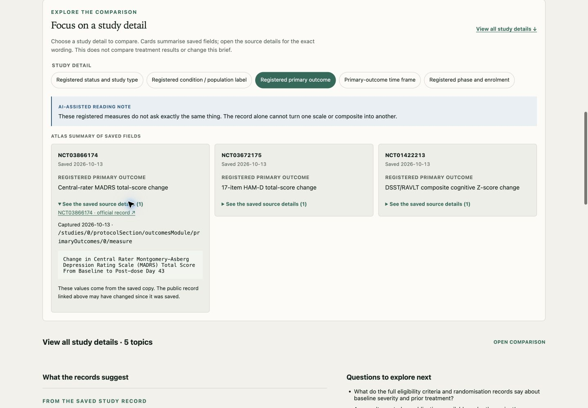

# Synapse Atlas

Explore how selected clinical studies were designed, inspect their saved source fields, and check what changed between record versions. Synapse Atlas turns those observations into a downloadable research brief with its evidence attached.

[Live site](https://synapse-atlas-theta.vercel.app/) · [Try the guided comparison](https://synapse-atlas-theta.vercel.app/studies?case=mdd-measurement-window) · [Latest product release: PR17](https://github.com/keithtgrehan/Synapse_Atlas/pull/17) · [Release record](CONTROL_ROOM.md)

**41 saved study records · 8 collections · 4 guided examples · 13 comparison topics**



## Try it in three minutes

1. Open the [depression-study example](https://synapse-atlas-theta.vercel.app/studies?case=mdd-measurement-window). Under **Explore the comparison**, choose a study detail such as the planned measurement or its time frame.
2. Compare the study-labelled cards, then open **See the saved source details** for the exact wording, saved date and official record link. Cards are authored Atlas summaries; the reading note is labelled AI-assisted.
3. Open **View all study details**, or keep the complete brief as a PDF, CSV table or JSON source bundle. Changing the selected topic changes only the view; the downloads retain the full case.

For a custom brief, [browse the catalogue](https://synapse-atlas-theta.vercel.app/catalogue), filter by collection or status and select up to four studies. **Check for updates** compares a saved record with one fresh ClinicalTrials.gov check per study during the visit. The three original records also support **Compare two saved versions**, which works from retained copies without a new registry request.

## Guided examples

| Example | Question to explore |
| --- | --- |
| [Depression: measure and timing](https://synapse-atlas-theta.vercel.app/studies?case=mdd-measurement-window) | How do the registered primary measurements and assessment windows differ? |
| [Add-on depression studies](https://synapse-atlas-theta.vercel.app/studies?case=adjunctive-inadequate-response) | What changes when studies use the same scale but define baseline and timing differently? |
| [Two saved record versions](https://synapse-atlas-theta.vercel.app/studies?case=registry-change-brief) | What can a comparison of two dated copies establish, and what remains unknown? |
| [MDMA-assisted therapy / PTSD](https://synapse-atlas-theta.vercel.app/studies?case=mdma-ptsd-design-context) | Which population and study-design details should be checked before comparing MAPP1 and MAPP2? |

[320px comparison](docs/screenshots/comparison-focus/comparison-mobile-320.jpg) · [390px MAPP example](docs/screenshots/comparison-focus/comparison-mapp-mobile-390.jpg)

## Evidence and limits

The catalogue is a selected, dated sample of official ClinicalTrials.gov records. The expansion preserved the original 13 records, added 26, then added two separately contextualized PTSD records. Collections can overlap; their counts do not represent complete market coverage or pooled results.

Saved copies remain immutable. Source disclosures retain exact field wording, NCT identifiers, capture dates and field locations; JSON bundles preserve source projections and integrity hashes for offline reconstruction. Official links may show later information. A live check stays in the current visit, and downloads make no additional registry request. Missing or ambiguous fields remain explicit.

Registered plans are not treatment results. Atlas supports research questions, not clinical decisions, treatment rankings or a complete record history. No patient data, account, database or live AI model call is needed for the demonstrated workflow.

## What was verified

For the product release on **23 November 2026**:

- **198 tests across 32 files**, lint, strict types, migration consistency and production build passed, followed by exact-head CI and protected Preview checks.
- All **13 topics across four examples** were exercised, including case reset, keyboard selection, source disclosure, custom study selection and layouts at 1440, 768, 390 and 320 pixels.
- The actual **seven-page Chrome print** of the widest MDD example passed **115 content/identity checks** and visual review: all five topics and three study columns print with the on-screen matrix closed. Saved/current/replay exports retain their validated evidence, and an actual current JSON bundle reconstructs offline.
- **17 anonymous public routes** passed after publication. No browser warning/error or production error/fatal log was captured during that verification window.

Scientific, graphic-design, UI and UX reviews were agent-assisted. They are not clinical adjudication or full accessibility certification. Print inspection covers the observed MDD/Chrome sample; user adoption, accuracy improvement and time savings have not been measured. Exact revisions, deployment evidence and rollback are in [CONTROL_ROOM.md](CONTROL_ROOM.md).

## Run locally

Use **Node.js 22** and **pnpm 10.18.3** from a repository checkout:

```sh
pnpm install --frozen-lockfile
pnpm dev
```

Open [localhost:3000](http://localhost:3000). Saved records and retained-version comparisons need no credentials or database setup. Fresh update checks require internet access to the approved ClinicalTrials.gov API; a failed check leaves saved records available. The optional database-health endpoint reports missing configuration when no database is configured.

```sh
pnpm check
node scripts/sync-how-it-works.mjs --check
```

`pnpm check` runs lint, types, tests, Drizzle consistency and the production build. The separate shared-document check keeps this README's detailed explanation aligned with the app.

## Explore the implementation

Next.js, React and TypeScript serve the catalogue and interactive brief. Deterministic comparison rules produce the version differences; jsPDF generates the downloadable PDF from the same selected records and case used by CSV/JSON.

- [Catalogue and captures](src/lib/snapshots/catalogue.ts) · [comparison rules](src/lib/snapshots/compare.ts) · [bounded ClinicalTrials.gov client](src/lib/sources/clinicaltrials/client.ts)
- [Focused comparison](src/app/studies/comparison-focus.tsx) · [case evidence](src/lib/cases/load.ts) · [session exports](src/app/studies/session-export.ts)
- [Research, original design rationale and optimized prompts](docs/competitive-design-review.md) · [release and design history](CONTROL_ROOM.md)

The public product is the PR17 release, revision `53ecde2e112fdf17b1c7ec04753db1afb52efffc`. Preview protection remains enabled, and [repository policy](vercel.json) disables automatic production deployment from `main`. Documentation-only updates do not require a product redeploy.

## Contribution

Keith Grehan set the research question, audience and product direction, authorized the scope, and reviewed the original three programme-to-study associations. Implementation, research support, testing and specialist reviews were developed with AI assistance. Ten later programme associations retain their model-proposed status; the NCT-first study workflow does not depend on those associations.

## Detailed product explanation

The following section is generated from [the app's shared content](src/lib/product/how-it-works.ts). Edit that source, then run `node scripts/sync-how-it-works.mjs`; use `--check` to verify synchronization.

<details>
<summary>Read how records, update checks, evidence and exports work</summary>

<!-- HOW_IT_WORKS:START -->
### Start with the study records

Synapse Atlas helps you explore how selected clinical studies were designed and what they planned to measure. It uses dated copies from ClinicalTrials.gov, a public database of clinical study records. Each record has an NCT ID, a unique study identifier. A record is not automatically a research paper or a report of results. Use Atlas to prepare questions and keep the sources with your summary, not to rank treatments or judge a business opportunity.

### Try the three-minute example

Open a guided example, or browse the study collections. Filter the list by collection and study status, then choose up to four studies. Collections can overlap; they are ways to explore a question, not groups whose results should be combined. Read the saved study details and the labelled AI-assisted notes. Open the source details to check the wording. Choose Check for updates, or Compare two saved versions where available. Then download a PDF summary, a CSV table and the JSON source data.

### Understand saved copies and update checks

A saved copy is the dated record Atlas starts with. Check for updates gets one new response for the selected NCT ID and keeps it during this visit. It does not continuously monitor the record. Compare two saved versions uses two copies saved earlier; it is not a live update. The page and downloads use the same records and checks. Reloading starts a new visit. The original saved records are never replaced, and new checks are not stored in a database. Study records can be compared without relying on the separate programme-to-study associations.

### Know what a comparison can tell you

A change in a public record does not show that a treatment works or that a study has made clinical progress. Main planned measurements, also called primary outcomes or endpoints, are not results. Missing information stays missing. If repeated entries cannot be matched reliably, Atlas shows both sources and marks the comparison as uncertain. Dates keep their reported level of detail and their Actual or Estimated labels. ClinicalTrials.gov has its own Record History; Atlas compares the selected saved versions, not the complete history.

### Check where the information came from

Source details show the saved wording, the study ID, where each field came from and when the copy was made. That saved date is separate from the public record’s last-update date. Technical checks validate IDs and fields and use SHA-256 checksums to identify the original response, the exported selection of fields and the normalized values separately. Source locations and processing/comparison versions are included. The JSON download contains the fields needed to reconstruct the comparison, including the public protocol fields cited by an example and bounded study-purpose text where needed. Unused contact fields are excluded. Further reading contains separate citation details, links and original notes. The full linked documents are not stored in the brief or included in its saved-record comparison.

### What has been checked

Automated tests check saved-record integrity, repeatable processing, changed and unchanged fields, missing information, partial dates, uncertain repeated entries, wrong IDs, failed requests and safe downloads. Tests use retained official records and deliberately altered test cases; these are not human clinical review labels. Browser checks cover example navigation, narrow screens, keyboard controls and downloads. Actual PDFs are compared with their matching CSV and JSON files and inspected as rendered pages for saved records, update checks, saved-version comparisons and custom selections. Long fields continue onto later pages. Unsupported font characters cause an explicit error rather than being discarded. These checks do not establish scientific truth or full accessibility conformance.

### Inside the application

Next.js, React and TypeScript serve the saved study list and a limited ClinicalTrials.gov API connection. Fixed comparison rules run on the two selected record versions. No account, database, vector search or live AI model call is needed. AI-assisted interpretation means Atlas reading notes written with AI assistance, not study findings. Counts describe the selected records; clinical results are not combined. Comparing a limited set of source fields makes the view reproducible, but cannot establish clinical significance or provide a complete drug-development pipeline.

### Keith’s contribution

Keith Grehan set the research question, audience and product direction, authorized the scope and reviewed the original three programme-to-study associations. The implementation, research support and testing were developed with AI assistance. Ten later associations remain model-proposed and approved for inclusion; they are not presented as independently reviewed scientific conclusions. No user adoption, accuracy improvement or time saving has been measured.
<!-- HOW_IT_WORKS:END -->

</details>
